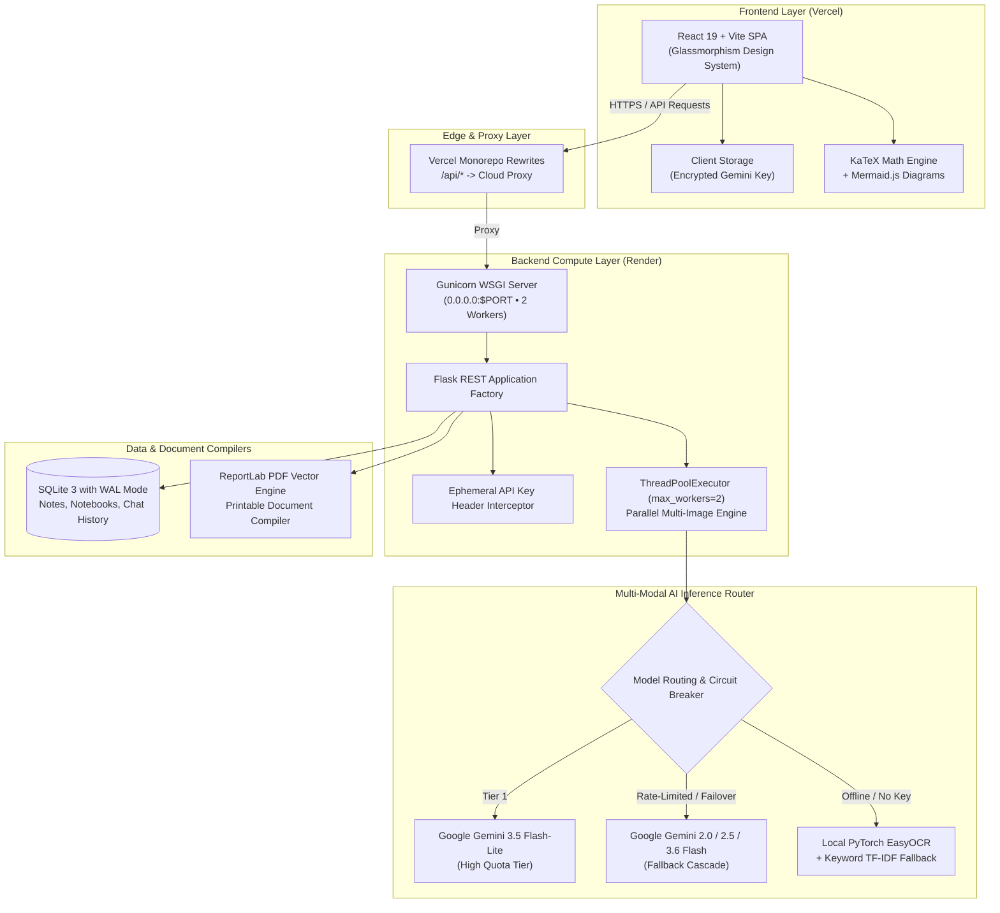

# NoteExtract AI — Multi-Modal Document Intelligence & Grounded RAG Platform

[](https://notesextract-ai.vercel.app/)
[](https://notesai-backend-i1u8.onrender.com/api/health)
[](https://www.python.org/)
[](https://react.dev/)
[](https://www.sqlite.org/)
[](https://ai.google.dev/)
[](https://www.reportlab.com/)

> **NoteExtract AI** transforms messy handwritten photos, whiteboard sketches, and scanned PDFs into clean, structured digital notes and multi-page notebooks. It provides an enterprise-grade **Grounded Federated RAG (Retrieval-Augmented Generation)** knowledge hub that answers questions across your entire library with **exact page-level source citations**.

---

## 🌐 Live Production Deployments

| Component | Platform | URL | Status |
| :--- | :--- | :--- | :--- |
| **Web Frontend (SPA)** | **Vercel** | [https://notesextract-ai.vercel.app/](https://notesextract-ai.vercel.app/) |  |
| **Backend REST API** | **Render** | [https://notesai-backend-i1u8.onrender.com/](https://notesai-backend-i1u8.onrender.com/api/health) | -34d399) |

*Note: The free Render backend enters sleep mode when idle. A built-in client-side awakening indicator gracefully notifies visitors while the instance warms up (~30–45s).*

---

## 🎥 Video Demonstration (LinkedIn Demo)

A Full HD 1080p walkthrough of the live deployed system is available directly in the repository:
* **Demo Video**: [`NoteExtract_AI_LinkedIn_Demo.mp4`](NoteExtract_AI_LinkedIn_Demo.mp4)
* **Showcases**:
  1. Real-time Render cloud engine status with self-healing reconnection.
  2. KaTeX mathematical formula rendering (Bayes' Theorem, SGD updates, Gaussian distributions).
  3. Interactive 19-page handwritten batch notebook reader with full-width reading & multi-page carousel navigation.
  4. Live LLMOps telemetry profiler (request counts, latency distributions, zero fallback rate).
  5. Grounded cross-workspace Federated RAG search with clickable source citations.

---

## 🌟 Key Features

### 1. 🧠 Grounded Federated RAG Knowledge Hub (`Ctrl+K`)
* **Multi-Document Reasoning**: Search and chat across all your single notes and multi-page notebooks simultaneously.
* **Clickable Source Citations**: AI answers include interactive badges (e.g. `[Deep Learning | Page 2]` or `[WhatsApp Image ... | Page 1]`). Clicking a badge instantly opens the reader to the exact source page with an animated locator banner.
* **Pre-Built Synthesizer Prompts**: 1-click prompts for cross-subject synthesis, formula extraction, multi-subject study quizzes, and exam cheat sheets.

### 2. ⚡ High-Throughput Parallel Batch Processor
* **Concurrent Ingestion**: Multi-threaded extraction via `concurrent.futures.ThreadPoolExecutor(max_workers=2)` processes multiple photos or PDF pages simultaneously.
* **Ordered Page Assembly**: Decoupled thread-safe disk persistence guarantees that pages are indexed and ordered correctly, reducing overall batch processing time by up to 50%.

### 3. 📖 Multi-Page Notebooks & Document Compilation
* **Batch Photo & PDF Ingestion**: Upload a multi-page PDF or a batch of handwritten notes; the system splits, extracts, and organizes them into an interactive notebook.
* **Vector PDF & Markdown Export**: 1-click export generating printable, publication-quality PDFs with custom styling and Table of Contents using **ReportLab**, or consolidated `.md` bundles.

### 4. 📐 Native LaTeX (KaTeX) & Mermaid Diagram Rendering
* Handwritten equations and math symbols automatically render via KaTeX (e.g. Euler's formula $e^{i\pi} + 1 = 0$, Fourier transforms, and neural loss gradients).
* System architecture workflows and mindmaps render into interactive, zoomable SVG diagrams via Mermaid.js.

### 5. 👁️ 3-Way Layout Verification Switcher
* `[ 📝 Notes Only ]`: 100% full-width, distraction-free reading and editing mode.
* `[ 📖 Split View ]`: 50/50 side-by-side verification comparing transcribed notes directly against the original untouched handwritten photo.
* `[ 🖼️ Photo Only ]`: Full-screen high-resolution zoom to inspect intricate diagrams, annotations, and sketches.

### 6. 🛡️ Fault-Tolerant Hybrid Architecture & Observability
* **Multi-Tier Model Routing**: Prioritizes high-quota `gemini-3.5-flash-lite`, with intelligent fallbacks across `gemini-2.0-flash`, `gemini-2.5-flash`, and `gemini-3.6-flash`.
* **Rate-Limit Circuit Breaker**: Automatically tracks HTTP 429 quota exhaustion in memory and cools down exhausted models for 2 hours, directing subsequent requests to available tiers.
* **Zero-Downtime Offline Fallback**: If no cloud API key is configured or the cloud is unreachable, NoteExtract AI seamlessly falls back to a local PyTorch EasyOCR engine and keyword-based TF-IDF search.
* **LLMOps Observability Dashboard**: Tracks token consumption, end-to-end latency, model fallback distribution, and error diagnostics in real time.
* **Zero-Trust Client Key Security**: Gemini API keys are stored strictly in browser `localStorage` and passed ephemerally via request headers. Keys are never logged or stored on the backend.

---

## 🏗️ System Architecture



---

## 🛠️ Tech Stack & Engineering Decisions

| Layer | Technologies | Rationale & Trade-offs |
| :--- | :--- | :--- |
| **Frontend** | React 19, Vite, Lucide, KaTeX, Mermaid.js | High-performance SPA with zero build overhead, rich typography, and dynamic micro-animations. |
| **Backend** | Python 3.11+, Flask, Gunicorn | Lightweight WSGI microservice architecture optimal for serverless containerized deployment. |
| **Concurrency** | Python `ThreadPoolExecutor` | Concurrent parallel OCR processing for batch images and multi-page PDFs with thread-safe persistence. |
| **Multi-Modal AI** | Gemini 3.5 Flash-Lite / 2.0 / 2.5 / 3.6 | Native multimodal transcription of handwriting with mathematical formula parsing and contextual grounding. |
| **Offline Fallback** | PyTorch, EasyOCR | Guarantees the application functions 100% locally with zero cloud dependencies or API keys. |
| **Database** | SQLite 3 (WAL Mode) | Zero-configuration ACID database with foreign keys, compound indexes, and persistent conversation memory. |
| **PDF Generation** | ReportLab 4.x, PyPDF 4.x | Programmatic vector PDF compilation with dynamic Table of Contents, page headers, and typography. |
| **Cloud Hosting** | Vercel (Frontend) + Render (Backend) | Free tier deployment with automated GitHub CI/CD and reverse-proxy route rewriting to bypass CORS. |

---

## 🔌 API Reference

### Single Notes
| Method | Endpoint | Description |
| :--- | :--- | :--- |
| `GET` | `/api/notes` | List notes with search, tag filters, favorites, and sorting |
| `POST` | `/api/notes` | Create a plain text or Markdown note |
| `POST` | `/api/notes/batch` | Batch create multiple notes in a single transaction |
| `GET` | `/api/notes/<id>` | Retrieve a note by ID |
| `PUT` | `/api/notes/<id>` | Update note title, content, tags, or favorite status |
| `POST` | `/api/notes/<id>/enhance-ai` | Trigger AI summarization, tag generation, or cleanup |
| `DELETE`| `/api/notes/<id>` | Delete note and cleanup disk uploads |
| `GET` | `/api/notes/<id>/export-pdf` | Stream printable PDF document |
| `GET` | `/api/notes/<id>/export-md` | Stream Markdown document |
| `POST` | `/api/upload` | Upload image, run OCR transcription, and generate draft note |

### Multi-Page Notebooks
| Method | Endpoint | Description |
| :--- | :--- | :--- |
| `GET` | `/api/notebooks` | List all multi-page notebooks with subject filter |
| `POST` | `/api/notebooks` | Create a new empty notebook container |
| `POST` | `/api/notebooks/upload-batch` | Concurrent parallel extraction from batch photos or PDF |
| `GET` | `/api/notebooks/<id>` | Retrieve notebook with all pages and cross-notebook links |
| `PUT` | `/api/notebooks/<id>` | Update notebook metadata (title, description, cover color) |
| `DELETE`| `/api/notebooks/<id>` | Delete notebook and cascade delete all associated pages |
| `POST` | `/api/notebooks/<id>/pages` | Add single or batch handwritten pages to existing notebook |
| `PUT` | `/api/notebooks/<id>/pages/<page_id>` | Edit a specific notebook page title or transcribed content |
| `DELETE`| `/api/notebooks/<id>/pages/<page_id>` | Delete a single page from a notebook |
| `POST` | `/api/notebooks/<id>/reorder` | Reorder pages within a notebook |
| `GET` | `/api/notebooks/<id>/export-pdf`| Compile and download multi-page vector PDF |
| `GET` | `/api/notebooks/<id>/export-md` | Download consolidated Markdown bundle |
| `POST` | `/api/notebooks/<id>/chat` | Grounded RAG chat scoped to notebook with page citations |
| `GET` | `/api/notebooks/<id>/chat` | Retrieve scoped chat history |
| `DELETE`| `/api/notebooks/<id>/chat` | Clear scoped chat history |
| `GET` | `/api/notebooks/<id>/related` | Retrieve semantically linked notebooks |

### Federated Workspace & Observability
| Method | Endpoint | Description |
| :--- | :--- | :--- |
| `POST` | `/api/workspace/chat` | Cross-notebook Grounded RAG with source attribution |
| `GET` | `/api/workspace/chat` | Retrieve global chat history |
| `DELETE`| `/api/workspace/chat` | Clear global conversation history |
| `GET` | `/api/stats` | Retrieve workspace counts (total notes, notebooks, pages) |
| `POST` | `/api/verify-key` | Validate Gemini API key validity and quota |
| `GET` | `/api/telemetry/stats` | Retrieve LLMOps latency, fallback counts, and model rates |
| `GET` | `/api/telemetry/logs` | Retrieve chronological execution and latency audit log |
| `DELETE`| `/api/telemetry/logs` | Reset LLMOps telemetry logs |
| `POST` | `/api/demo/seed` | 1-Click idempotent demo data seeding |
| `DELETE`| `/api/demo/clear` | Clear demo-tagged sample documents |
| `GET` | `/healthz`, `/api/health` | Health check endpoint returning HTTP 200 |

---

## 🚀 Local Development Setup

### Prerequisites
* **Python**: 3.10 or higher
* **Node.js**: 18.0 or higher

### 1. Clone the Repository
```bash
git clone https://github.com/mayurmohite4848/new.git
cd new
```

### 2. Universal 1-Command Launcher
You can boot both the Flask backend and Vite React frontend with a single command:
```bash
python run.py
```
*(On Windows: `py run.py`)*

* **Frontend**: [http://127.0.0.1:5173](http://127.0.0.1:5173)
* **Backend API**: [http://127.0.0.1:5000/api/health](http://127.0.0.1:5000/api/health)

### 3. Running Automated Tests
Run the complete unit and integration test suite:
```bash
python -m unittest discover -s backend/tests
```

---

## 📄 License
This project is open-source under the [MIT License](LICENSE).
